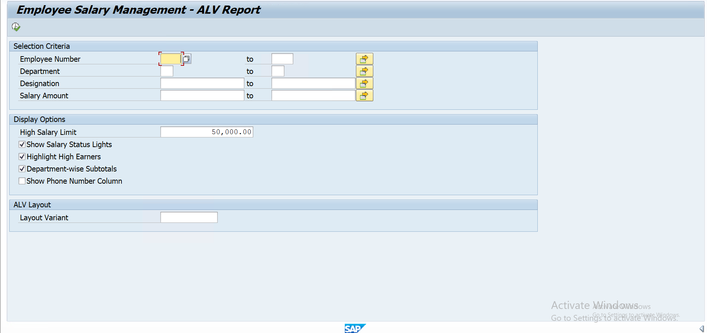
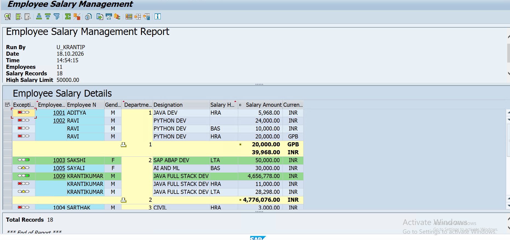
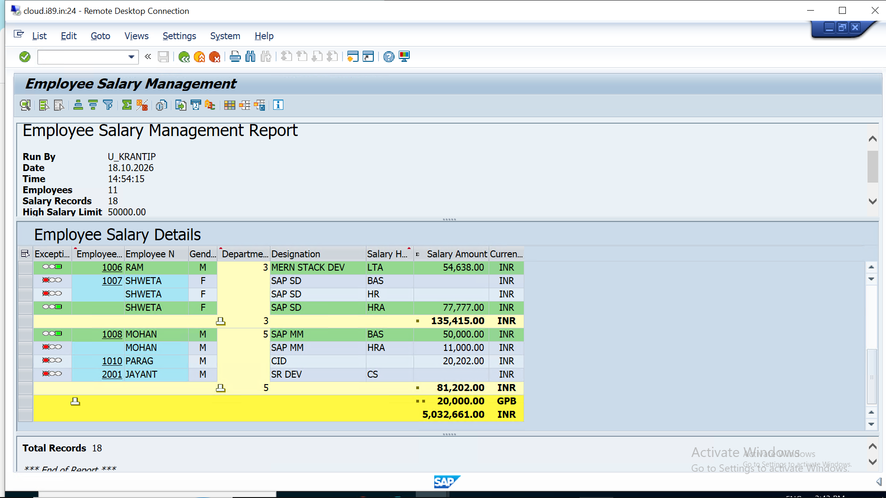

# Employee Salary Management - ALV Report (SAP ABAP)


An interactive ALV Grid report in SAP ABAP that displays employee salary data by joining the employee master and salary master tables. It includes traffic lights, row colors, subtotals, layout variants, popups and many other ALV features.

**Program name:** `Y182_EMP_SALARY_ALV`

---

## Table of Contents

- [Screenshots](#screenshots)
- [Database Tables](#database-tables)
- [Features](#features)
- [Selection Screen](#selection-screen)
- [ALV Output](#alv-output)
- [ALV Function Modules Used](#alv-function-modules-used)
- [Installation](#installation)
- [How to Run](#how-to-run)
- [Optional: Custom GUI Status](#optional-custom-gui-status)
- [Requirements](#requirements)
- [Future Enhancements](#future-enhancements)
- [Author](#author)
- [License](#license)

---

## Screenshots

### 1. User Input Window (Selection Screen)



### 2. Output Window (ALV Grid Output)





---

## Database Tables

| Table | Description |
|-------|-------------|
| `Y182M_EMPMST` | Employee master data |
| `Y182M_SALMST` | Employee salary master data |

**Join condition:** `Y182M_EMPMST-EMPNO = Y182M_SALMST-EMPNO`

| Field | Source Table | Meaning |
|-------|--------------|---------|
| `EMPNO` | `Y182M_EMPMST` | Employee number |
| `EMPNM` | `Y182M_EMPMST` | Employee name |
| `GENDER` | `Y182M_EMPMST` | Gender |
| `DEPTCD` | `Y182M_EMPMST` | Department code |
| `DESIGNATION` | `Y182M_EMPMST` | Designation |
| `PHONE_NO` | `Y182M_EMPMST` | Phone number |
| `SALHD` | `Y182M_SALMST` | Salary head |
| `SALARY` | `Y182M_SALMST` | Salary amount |
| `WAERS` | `Y182M_SALMST` | Currency key |

The program adds three helper columns that only control the display and are not stored in the database: `LIGHT` (traffic light), `BOX` (row checkbox) and `ROWCOLOR` (row color).

---

## Features

| Feature | Description |
|---------|-------------|
| Field catalog | DDIC references, key columns, hotspot, hidden phone column, alignment |
| Layout | Zebra rows, optimized column width, window title, exit confirmation, detail popup |
| Traffic lights | Green: salary at or above the limit. Yellow: at or above 50% of the limit. Red: below 50% |
| Row colors | High earners are highlighted in green |
| Checkbox column | Select rows and show the count and total salary per currency |
| Sort and subtotals | Sorted by department, employee and salary head, with department subtotals and a grand total |
| Currency-aware totals | Totals are split per currency automatically |
| Layout variants | F4 help, default variant and variant validation |
| Top of page | User, date, time, employee count, record count, limit and a color legend |
| End of list | Total records footer |
| Hotspot / double-click | Opens a popup ALV with the selected employee's salary details |
| Custom commands | `ZSELECT` (selected rows summary) and `ZREFRESH` (reload data) |
| Print settings | Cover page and selection info switched off |
| Standard toolbar | Filter, sort, find, Excel export, print, detail view, change layout |

---

## Selection Screen

| Field | Description |
|-------|-------------|
| Employee Number | Range of `EMPNO` |
| Department | Range of `DEPTCD` |
| Designation | Range of `DESIGNATION` |
| Salary Amount | Range of `SALARY` |
| High Salary Limit | Threshold used for lights and row colors (default 50000) |
| Show Salary Status Lights | Turn traffic lights on or off |
| Highlight High Earners | Turn row colors on or off |
| Department-wise Subtotals | Turn subtotals on or off |
| Show Phone Number Column | Show or hide the phone column |
| Layout Variant | Choose a saved ALV layout |

---

## ALV Output

| Column | Field |
|--------|-------|
| Status light | Based on the high salary limit |
| Selection checkbox | Select rows for the summary button |
| Employee Number | `EMPNO` (clickable) |
| Employee Name | `EMPNM` |
| Gender | `GENDER` |
| Department | `DEPTCD` |
| Designation | `DESIGNATION` |
| Phone Number | `PHONE_NO` (hidden by default) |
| Salary Head | `SALHD` |
| Salary Amount | `SALARY` (with totals) |
| Currency | `WAERS` |

---

## ALV Function Modules Used

- `REUSE_ALV_GRID_DISPLAY`
- `REUSE_ALV_EVENTS_GET`
- `REUSE_ALV_COMMENTARY_WRITE`
- `REUSE_ALV_POPUP_TO_SELECT`
- `REUSE_ALV_VARIANT_DEFAULT_GET`
- `REUSE_ALV_VARIANT_F4`
- `REUSE_ALV_VARIANT_EXISTENCE`

---

## Installation

1. Make sure the tables `Y182M_EMPMST` and `Y182M_SALMST` exist in your SAP system with the fields listed above.
2. Open transaction **SE38** and create an executable program named `Y182_EMP_SALARY_ALV`.
3. Copy the code from `y182_emp_salary_alv.abap` into the program.
4. Save and activate (**Ctrl + F3**).

---

## How to Run

1. Open **SE38**, enter `Y182_EMP_SALARY_ALV` and press **F8**.
2. Fill the selection screen, or leave it blank to see all records.
3. Set the high salary limit and display options.
4. Press **F8** (Execute).
5. Click an employee number, or double-click a row, to open the employee details popup.
6. Use the toolbar to filter, sort, export to Excel, print or save a layout variant.

---

## Optional: Custom GUI Status

The report works with the standard status `STANDARD_FULLSCREEN`. To enable the custom buttons *Selected Summary* and *Refresh*:

1. Open **SE41**.
2. Copy status `STANDARD_FULLSCREEN` of program `SAPLKKBL` to your program `Y182_EMP_SALARY_ALV` with the name `ZSALARY_ALV`.
3. Add two buttons to the application toolbar with function codes `ZSELECT` and `ZREFRESH`.
4. Activate the status.
5. In the code, change the constant:

```abap
CONSTANTS gc_custom_status TYPE abap_bool VALUE abap_true.
```

---

## Requirements

- SAP system with **ABAP 7.40 SP08 or higher** (uses inline declarations and `@` host variables)
- Authorization to create and run programs (SE38)
- The tables `Y182M_EMPMST` and `Y182M_SALMST` with data

---

## Future Enhancements

- Convert the report to object-oriented ALV (`CL_SALV_TABLE`)
- Add authority checks for department-wise access
- Add currency conversion to compare salaries across currencies
- Add a graphical view (bar chart of salary by department)
- Add unit tests with ABAP Unit

---

## Author

**Krantikumar Patil**

SAP ABAP Developer


---
